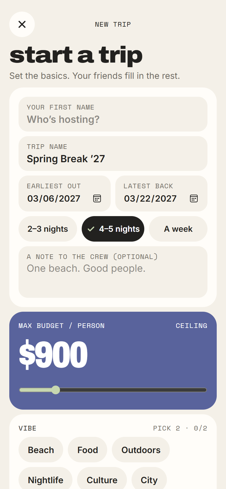
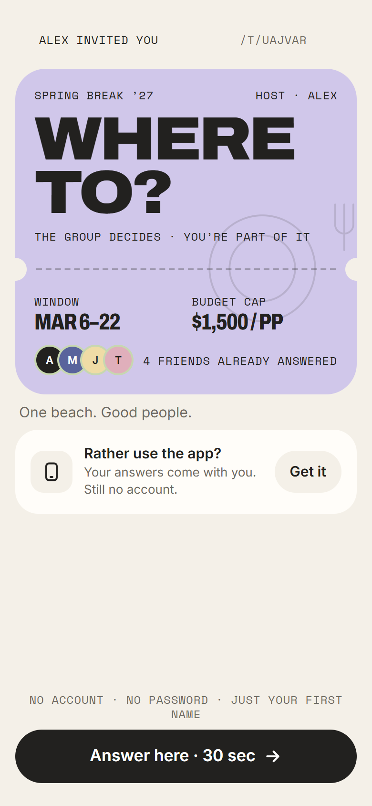
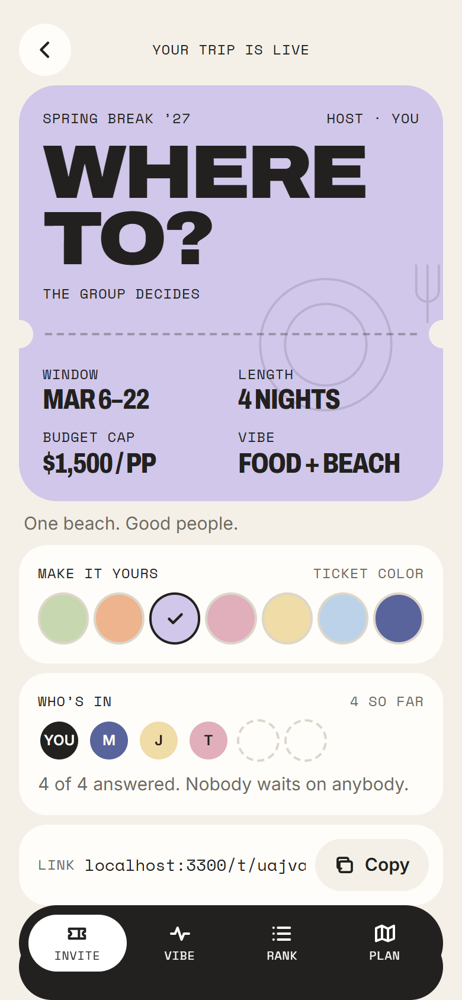
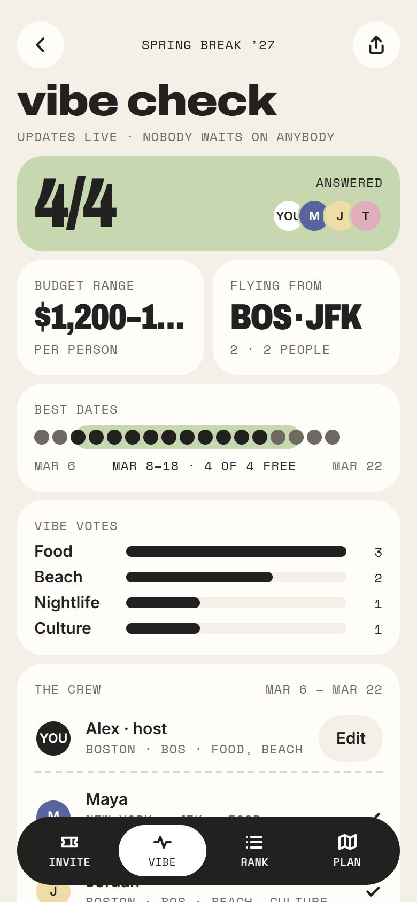
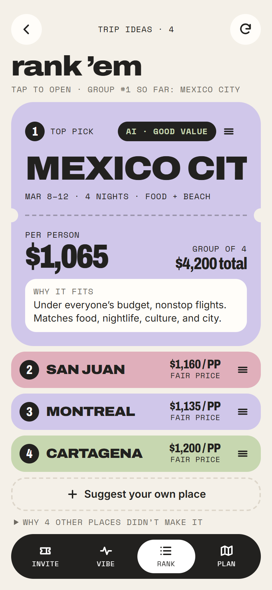
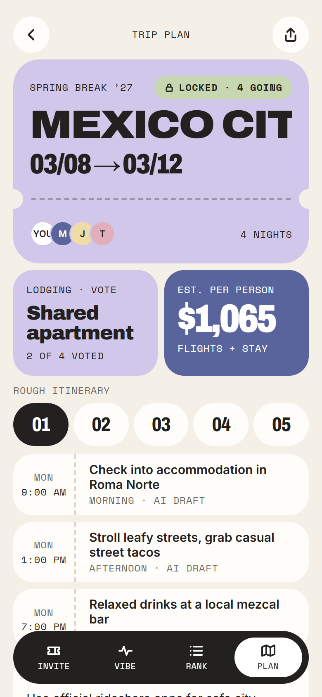

# Tripflow

**Plan a group trip everyone can say yes to.** One person starts a trip and sends a link. Friends open it on their phones, answer a few quick questions, and rank the places AI suggests. The group's top pick becomes the plan, with a day-by-day itinerary.

No app to install and no account to create.

**Try it:** https://hackrpi-26.vercel.app

## The problem

Group trips die in the group chat. One person floats a weekend, everyone replies with different dates and budgets, and the thread goes quiet before anyone picks a place. Tripflow turns that chat into a short, friendly flow where everyone's answers count and the group decides together.

## How it works

1. **Start a trip.** Name it, pick a rough date window, a trip length, a max budget and a vibe. You get an invite link.
2. **Send the link.** Friends open it in their browser. They only give a first name, with no sign-up and no password.
3. **Everyone answers.** Home airport, their own budget (kept private), dates they can do, passport and hard nos, and what they want from the trip.
4. **Check the vibe.** A live summary shows who has answered, the group's budget range, the dates that work for everyone, and what people want. It also nudges anyone who hasn't answered.
5. **Rank 'em.** AI suggests places that fit the group's airports, dates and budgets. Tap a place to see its price and why it fits, drag to reorder, or suggest your own place and let AI price it. Lock in your ranking.
6. **It's happening.** When everyone has locked in, the group's top pick becomes the plan. Everyone says "I'm in", votes on where to stay, and gets an AI-drafted itinerary they can edit and add to their calendar.

For a layer-by-layer look at the system, see [Architecture](docs/ARCHITECTURE.md).

## Screenshots

<table>
  <tr>
    <td align="center" width="33%"> <b>Start a trip</b> Set the basics in one screen</td>
    <td align="center" width="33%"> <b>The invite link</b> What a friend sees, no account needed</td>
    <td align="center" width="33%"> <b>Invite the group</b> Pick a ticket color and share the link</td>
  </tr>
  <tr>
    <td align="center" width="33%"> <b>Vibe check</b> Who answered, budgets, best dates</td>
    <td align="center" width="33%"> <b>Rank 'em</b> Open, compare and drag to reorder</td>
    <td align="center" width="33%"> <b>Trip plan</b> Locked trip, stay vote and itinerary</td>
  </tr>
</table>

## Highlights

- **Link first.** A trip is a link. Anyone with it can join from a phone browser, and each device keeps its own private token, so people can only act as themselves.
- **Private budgets.** The group sees a range, never one person's number.
- **AI that helps, not blocks.** Gemini suggests destinations, prices places you add yourself, and drafts the itinerary. If it's slow or unavailable, the app falls back to sample destinations and lets you retry.
- **Decide, don't debate.** Everyone ranks, the group's top pick rises on its own, and the trip locks when everyone has.
- **Made for phones.** A ticket-stack design with big type, one main button per screen, and drag-to-rank that works with a thumb.
- **Take it with you.** Add the plan to your calendar, copy the itinerary, or install the app to your home screen.

## Built with

Next.js, React and TypeScript, styled with Tailwind. Trips are stored in Upstash Redis, AI comes from the Gemini API, and drag-to-rank uses dnd-kit. It's deployed on Vercel.

## Deploying your own

1. Import the repository into Vercel.
2. Add the **Upstash Redis** integration to the project. It supplies the database variables (`KV_REST_API_URL` and `KV_REST_API_TOKEN`).
3. Optional: add `GEMINI_API_KEY` to turn on AI destination ideas, pricing and itineraries.
4. Redeploy so the new variables take effect.

See `.env.example` for the full list of settings.
